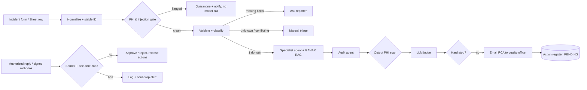

# AI-Powered Hospital Incident Management & Patient Safety System (GAHAR-aligned)

One integrated **n8n** workflow that takes an incident report from a data-collection form, screens it for patient identifiers and prompt injection, classifies it, drafts an evidence-limited root-cause analysis (RCA) grounded in the **GAHAR Hospital Accreditation Standards 2025**, scores the draft with an LLM-as-judge, and then waits for an **authorized quality officer to approve by email** before any action is released.

> **Status: proposal-grade build, not yet validated.** The workflow was statically validated (89 nodes, 83 connections, every Code node parses and was unit-tested on sample inputs) but has **not been executed end-to-end in a live n8n instance**. All KPI "actuals" are pending. Use synthetic data only.

- Workflow (single file, uncompressed): [`workflows/ai-hospital-incident-management-gahar.json`](workflows/ai-hospital-incident-management-gahar.json)
- Pitch (PDF): [`pitch/AI_Incident_Management_Pitch.pdf`](pitch/AI_Incident_Management_Pitch.pdf)
- GAHAR reference notes: [`docs/GAHAR_STANDARDS_REFERENCE.md`](docs/GAHAR_STANDARDS_REFERENCE.md)
- Test plan / issue log: [`docs/TEST_PLAN.md`](docs/TEST_PLAN.md), [`docs/ISSUE_LOG.md`](docs/ISSUE_LOG.md)

## How it works



Everything lives in **one workflow**, laid out as lanes (sticky notes label each stage):

| Lane | Stage | Proposal ref |
|---|---|---|
| Top | Intake, PHI gate, validation, triage, specialists, audit, judge, review email | W1-W5 stages |
| Backend (y≈900) | IMAP mailbox + approval webhook -> authorization -> action register | W4 |
| GAHAR KB (y≈1300) | Downloads the official GAHAR 2025 handbook, chunks, embeds | W3 |
| Dashboard (y≈1700) | `GET /webhook/incident-dashboard?token=…` KPI page | W5 |
| Error (y≈2000) | Failed-run logging and alert | W5 |

### Backend: receiving the authorized quality report by mail
1. The workflow emails the draft RCA to `QUALITY_OFFICER_EMAIL` with subject `[GAHAR-RCA] <incident_id> - Review required`.
2. The reviewer replies, first line `APPROVED`, `REJECTED` or `REQUEST EDITS`, plus `CODE:`, `OWNER:`, `DUE:`, `COMMENT:`.
3. The **IMAP trigger** picks up unread mail whose subject contains `[GAHAR-RCA]`. A decision is accepted only if **all** hold: sender is in `AUTHORIZED_APPROVERS`, the one-time `CODE` matches (SHA-256 of incident ID + `APPROVAL_TOKEN`), the incident ID and decision parse, and `APPROVAL_TOKEN` is configured. Anything else is logged to `UnauthorizedAttempts` and raises a hard-stop alert; **nothing is released**.
4. A signed webhook (`POST /webhook/incident-approval`, header `x-approval-token`) feeds the same checks, for non-email clients.

### GAHAR rules built in (verified against GAHAR sources, see docs)
- Knowledge base = GAHAR *Handbook for Hospital Accreditation Standards, 2025 edition (2nd ed.)* downloaded from gahar.gov.eg. Agents may cite a standard code **only** if the retrieval tool returned it; otherwise the draft is flagged `unverified`.
- Suspected serious harm (`severe` / `death` / `permanent`) raises an urgent alert with the GAHAR timelines: **notify GAHAR within 48 hours, RCA within 45 days**. The system **does not decide reportability** - the quality officer does.

## Setup

1. **n8n** (self-hosted recommended). Set environment variables (see `.env.example`), including `NODE_FUNCTION_ALLOW_BUILTIN=crypto` and leave `N8N_BLOCK_ENV_ACCESS_IN_NODE` unset/false.
2. **Google Sheet** with tabs (header rows in `data/sheet_templates/`): `Incidents`, `IntakeLog`, `Quarantine`, `ValidationErrors`, `ManualTriage`, `JudgeScores`, `ActionRegister`, `UnauthorizedAttempts`, `FailedRuns`. Put its ID in `INCIDENT_SHEET_ID`.
3. **Import** the JSON (Workflows -> Import from file). Create credentials: Google Sheets (+ Trigger), OpenAI, Telegram, SMTP, IMAP; assign them to the nodes marked `REPLACE_ME`.
4. In workflow **Settings**, set *Error workflow* to this workflow.
5. Run **Load GAHAR Standards (manual)** once (the vector store is in-memory, so repeat after each n8n restart; a monthly refresh trigger is included).
6. Activate. Submit incidents through the n8n form (`/form/incident-report`) or by adding a row to the `Incidents` tab (headers: `incident_type, department, description, harm_occurred, person_affected, harm_description, reporter_email`).
7. Optional tracing: set `LANGCHAIN_TRACING_V2=true`, `LANGCHAIN_API_KEY`, `LANGCHAIN_PROJECT` for LangSmith. Never send identifiers to traces.

## Testing
Load `data/synthetic_incidents.csv` into the `Incidents` tab and follow [`docs/TEST_PLAN.md`](docs/TEST_PLAN.md) (3 normal, 1 edge, 1 unsafe per stage, plus the three end-to-end scenarios). Static check without n8n:

```bash
python3 scripts/validate_workflow.py workflows/ai-hospital-incident-management-gahar.json
```

## Safety boundaries
Synthetic data only; AI drafts, a human decides; no diagnosis/treatment advice; no automatic regulatory reportability decision; no autonomous patient communication; unknown or conflicting classification goes to manual triage, never to low risk.

## Known limitations (read before demoing)
- Not yet run in a live n8n instance: confirm node parameter formats after import (notably the in-memory vector store `memoryKey` locator, Form Trigger, IMAP options) - n8n versions differ.
- PHI gate is regex-based (national ID, Egyptian mobile, MRN, email, labelled names; Arabic-Indic digits normalized). It **cannot detect free-text personal names** - treat as one layer, not proof of de-identification. Source-sheet rows keep the raw text; restrict access or use the form.
- Judge uses `gpt-4o-mini`; for independence use a different model family and calibrate against two human raters (not yet done).
- Email sender addresses can be spoofed; the one-time code and (recommended) SPF/DKIM enforcement on the mailbox mitigate this.
- Routing is keyword-based on a fixed dropdown; measure accuracy on a gold-labeled set before claiming ≥90%.
- Baseline 20 min/report is an **assumption** to be timed locally.

## License
MIT (see `LICENSE`). Replace with your institution's preference if needed.
