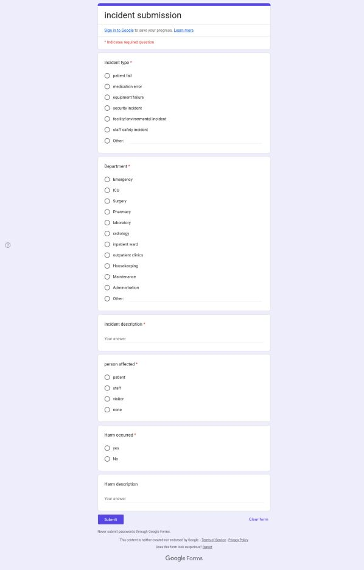

# Healthcare Incident Report Review Support — GAHAR 2025

> **Disclaimer:** This is a prototype that supports the quality team. It is not approved by GAHAR, does not establish hospital compliance, and does not determine whether an incident is reportable. Every result requires human review.

## GitHub About description

Copy this short description into the repository’s **About** field:

> n8n prototype connecting Google Forms/Sheets to AI agents for retrieving selected GAHAR 2025 hospital standards, analyzing gaps, and proposing action plans for human review, with LangSmith tracing and evaluation.

**Technologies:** n8n, Google Forms and Google Sheets, n8n LangChain nodes, OpenAI models, retrieval-augmented generation (RAG) using an in-memory vector store, LangSmith, SMTP/IMAP, Telegram, and webhooks.

## Project overview

The workflow receives a new incident report from a Google Form linked to a Google Sheet. It validates the fields and performs an initial pattern-based check for selected sensitive-data patterns, then routes the report to a specialist agent. Separate agents review how the report’s evidence relates to retrieved GAHAR standards and propose gaps, actions, and recommendations. A draft report is emailed to the quality team. Decisions and actions remain pending until an authorized person reviews and approves them.

The single JSON workflow contains 107 nodes, including intake, classification, review, and reporting paths; a GAHAR handbook loader; notifications and an action register; and LangSmith tracing/evaluation. This does not mean that every node or connection has been tested in a live n8n instance.

## Workflow images

### Incident form

The form collects the incident type, department, a description without names or identifying numbers, the affected person’s role, whether harm occurred, and a brief description of harm when applicable.

### n8n workflow

The main path starts when a new row appears in the form response sheet. If the initial check detects a selected sensitive-data pattern or possible prompt-injection wording, the report is routed to quarantine and notification instead of automated review. Reports that pass the check proceed through validation and classification, a specialist agent, GAHAR reference validation, gap analysis, an action plan, and a final audit. An HTML report is then created and emailed. Separate paths load the handbook into the vector store and handle human approval, logging, and the monitoring dashboard.

## Requirements

- An n8n version that supports Google Sheets Trigger, the LangChain nodes included in n8n (`@n8n/n8n-nodes-langchain`), and the Google Sheets, OpenAI, SMTP/IMAP, Telegram, webhook, and Extract From File nodes.
- A Google account and OAuth access to read the form-linked Google Sheet and write to the log sheets.
- Valid OpenAI credentials for the models selected in the JSON: `gpt-4o`, `gpt-4o-mini`, and an embeddings model.
- An SMTP mailbox for sending reports and an IMAP mailbox for receiving review decisions.
- A Telegram account and bot/channel for notifications, if you want to enable them.
- A LangSmith account and API key if you want tracing and evaluation. LangSmith is optional. Do not send patient information to it until the organization has approved the privacy configuration.

## Set up Google Forms and Google Sheets

1. Create a Google Form and link it to a Google Sheet. The response tab must be named `Form Responses 1`, because the trigger in the JSON watches that tab.
2. Use the fields shown in the form image. The workflow expects columns corresponding to incident type, department, description, affected person’s role, whether harm occurred, and a description of the harm. Reporter email is optional. If you change question titles, update the column names in the `Normalize Incident Row` node.
3. Create or check the log tabs used by the workflow: `Quarantine`, `IntakeLog`, `ValidationErrors`, `ManualTriage`, `JudgeScores`, `ActionRegister`, `UnauthorizedAttempts`, and `FailedRuns`. Make sure the column headers match the mappings in the Google Sheets nodes. Use synthetic data during testing.

## Import and run the workflow in n8n

1. Download [`ai-hospital-incident-management-gahar-final (1).json`](./ai-hospital-incident-management-gahar-final%20%281%29.json) from the repository root.
2. In n8n, create a new workflow and choose **Import from File** from the workflow menu, then select the JSON file. The menu wording may vary slightly by n8n version.
3. Open nodes that contain `REPLACE_ME` credentials and connect the appropriate accounts in n8n **Credentials**. Google Sheets, OpenAI, SMTP, IMAP, and Telegram credentials are required. Do not put passwords or API keys in the JSON file or this repository.
4. Set the required environment variables in the n8n environment or your approved secrets manager. Do not commit a `.env` file containing secrets to GitHub:

   - `INCIDENT_SHEET_ID`: ID of the Google Sheet containing form responses and log tabs.
   - `QUALITY_TEAM_EMAILS`: comma-separated quality-team email addresses. `QUALITY_OFFICER_EMAIL` can be used as a fallback if this is not set.
   - `SMTP_FROM`: sender address authorized by the SMTP account.
   - `AUTHORIZED_APPROVERS`: comma-separated list of email addresses allowed to approve decisions.
   - `APPROVAL_TOKEN`: strong random secret required to issue and validate approval decisions. Store it in a secrets manager and do not share it.
   - `TELEGRAM_CHAT_ID`: ID of the chat/channel used for notifications.
   - `DASHBOARD_TOKEN`: random secret used to protect the monitoring dashboard endpoint.
   - `LANGSMITH_API_KEY`: required only to log runs and feedback to LangSmith.
   - `LANGSMITH_ENDPOINT`: optional; defaults to `https://api.smith.langchain.com`.
   - `LANGSMITH_PROJECT` or `LANGCHAIN_PROJECT`: project/session name in LangSmith when tracing is enabled.
   - `LANGSMITH_REDACT_TEXT=true`: omits the description field from the workflow’s manual LangSmith run payload. This is **not** comprehensive data redaction and does not automatically disable content capture by native LangChain tracing.

   Configure SMTP, IMAP, Google, OpenAI, and Telegram credentials in n8n’s Credentials interface, not in this README. If your environment blocks node access to environment variables, use the secrets configuration supported by your n8n version or safely adapt the expressions to an approved secrets mechanism.
5. Run **Load GAHAR Standards (manual)** once to load the 2025 hospital handbook into the vector store. The workflow uses an in-memory store, so reload the handbook after restarting n8n. A monthly refresh schedule is also included.
6. Review node warnings after import, especially Google Sheets Trigger, Extract From File, IMAP, and vector-store options, which may vary by version. Confirm that the trigger watches `Form Responses 1` every minute and that webhook endpoints are available over HTTPS if used.
7. Test with synthetic data only. Monitor **Executions**, confirm that the report arrives in a test mailbox and that results appear in the log sheets, and verify that a decision from an unauthorized sender or without the required code does not release actions. Do not enable operational use until privacy/security checks and test outputs have been approved.
8. Once testing is complete, activate the workflow. The emailed report remains a draft for review. An authorized human decision updates the action register to approved, rejected, or changes requested.

## Synthetic demo example

**This is an illustrative example of the output format, not an actual run result or a guaranteed model response.** Classifications and wording may vary based on model settings and retrieved handbook passages.

**Synthetic incident report:**

- Incident type: medication error / near miss.
- Department: Pharmacy.
- Description: “During the final check, a pharmacist noticed a dose mismatch on the label before the dose was sent to the ward. The dose was withheld, and the prescription and label were escalated to the responsible pharmacist. No patient received the dose, and no harm was reported.”
- Person affected: none.
- Harm occurred: no.
- Patient data: this example contains no names, numbers, or identifying information.

**The generated report might include:**

- **Route:** clinical, based on keyword classification in the report.
- **GAHAR validation:** the review of incident-reporting processes may be linked to `QPI.10`. If the report does not include evidence of the hospital’s policy, staff training, investigation, or corrective actions, the result should be “Insufficient evidence,” not “Not met.” Missing information in an incident report does not prove that the hospital process is absent.
- **Gap analysis:** a suggestion to verify documentation of the incident/near miss and review medication label preparation and checking steps. These are hypotheses to investigate, not established root causes.
- **Proposed action plan:** review the case with the quality lead and pharmacist, check dose/label matching controls, and assign an owner, due date, and success measure. The team must approve or revise the action and due date.
- **Decision:** the report remains labeled as an unapproved AI draft. Actions are not released until an authorized person reviews it.

## Standards referenced and coverage limits

The workflow loads the **GAHAR Handbook for Hospitals Standards 2025** into its retrieval knowledge base. References should remain attached to the report, and the reviewer should verify that each cited code appeared in the retrieval results. [Official GAHAR Hospital Standards Handbook 2025](https://gahar.gov.eg/upload/gahar-handbook-for-hospitals-accreditation-standards-2025---v2.pdf)

- **QPI.09 — Risk Management Program/Plan:** The project can support the identification of risks related to incidents and propose priorities, mitigation actions, and monitoring measures. It does not independently establish or maintain the hospital-wide risk register, prove comprehensive risk assessments, implement an annual proactive risk tool, or provide periodic governance reports. Support is therefore partial.
- **QPI.10 — Incident Reporting System:** The workflow supports report intake, initial validation and classification, and preparation of analysis, potential gaps, proposed actions, and an action register. It does not prove that the hospital has an approved policy, has trained all staff, maintains a complete reportable-incident list, or fulfills all requirements for communication and support after harm. This is assistance, not proof of compliance.
- **QPI.11 — Sentinel Events:** The workflow can flag indicators for escalation and prepare a draft RCA and action plan for human review. It does not decide whether an event is reportable, send an official notification to GAHAR, submit an official RCA, guarantee a deadline, or prove that the hospital has a sentinel-event policy or governance oversight.

**Important deadline note:** The general overview in the 2025 handbook says to notify GAHAR within 48 hours, while the detailed QPI.11 text says within two working days. Both passages refer to a 45-day deadline for the root cause analysis and action plan. The quality/compliance team should confirm the applicable interpretation against the latest GAHAR documentation and hospital policy. The current code also calculates 48 hours and 45 days from workflow execution time, not necessarily from the incident’s occurrence or the time the hospital became aware of it. Do not rely on the automated dates until they have been updated and verified.

The project does not cover every GAHAR standard and does not replace formal assessment, institutional evidence, or an accreditation survey. “GAHAR-referenced” describes the selected source and mapping only; it does not mean the project is accredited or fully compliant.

## AI limitations and human review

The model may misinterpret an incident, confuse facts with assumptions, or propose an unsuitable gap, deadline, or action. Retrieval may be incomplete or fail to return the relevant passage. Automated evaluation and LangSmith scores support monitoring; they do not establish clinical or legal accuracy or accreditation compliance.

The quality officer must review the facts, standard references and cited evidence, risk classification, and reportability, then review every gap, action, owner, deadline, and success measure. Do not use the report for diagnosis, treatment, or staff blame, and do not send an official GAHAR notification based on an automated decision. Email/webhook approval records a decision by an authorized reviewer; it does not replace the review itself.

## Patient-data privacy and security

**Do not enter real patient data into the current version.** Use synthetic or approved de-identified data for testing until the organization’s privacy, information-security, and legal officers have approved the data flow, service providers, and retention periods.

The current privacy check uses limited regular expressions for patterns such as a 14-digit Egyptian national ID, some phone and email formats, an `MRN` label, or the phrase `patient name`. It will not detect every name, record number, or detail that could identify someone. More importantly, when a report passes the check, the workflow copies the original description into `description_sanitized`. A name written naturally in the text may therefore reach AI models, Google Sheets, email, and n8n execution logs. The field name and pattern check do not guarantee de-identification.

`LANGSMITH_REDACT_TEXT=true` also omits the description from the manual LangSmith run payload only. It does not redact Google Sheets, n8n logs, or email, and does not guarantee that native LangChain tracing hides content. Disable or configure tracing that captures inputs and outputs, or use an internally hosted/approved LangSmith environment after reviewing its settings. Restrict access and retention, secure webhook URLs, and never store API keys in GitHub.

Before production use, the workflow must be modified to actually redact text or pause it for review when identifying information may be present. All fields, logs, and backups must be reviewed, and tests must confirm that data is not sent to unapproved services.

## LangSmith tracing and evaluation

When a LangSmith API key is configured, the workflow records a project run and selected evaluation measures, such as judge scores, the proportion of retrieved references that were verified, and action coverage of identified gaps. The JSON also includes LangChain tracing configuration through environment variables. Start with synthetic data and manually inspect run and feedback contents before using any real data. Gold labels or model scores are not an independent benchmark of system quality.

## Current status

The repository contains a single exported workflow. According to the project notes, its structure and some node logic were checked offline, but it has not been verified end-to-end in a live n8n account. Nodes may need adjustment for the n8n version and account settings. Test it in a safe environment with synthetic data before any broader use.

## License

The repository contains an MIT License file. Check that the license and your organization’s policy are appropriate before redistributing the project or adding files containing internal information.
